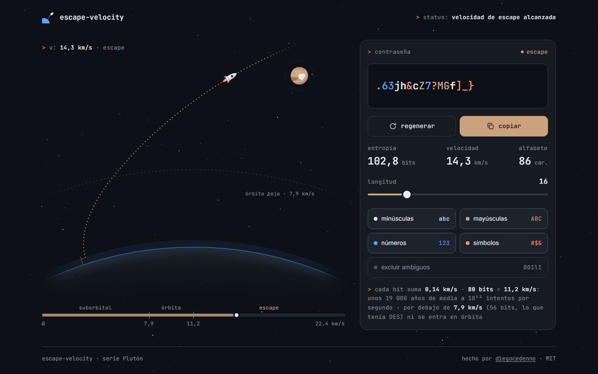

# escape-velocity

> A password generator where strength is a launch: entropy becomes the speed of a rocket trying to reach Earth's escape velocity, 11.2 km/s.
>
> Un generador de contraseñas donde la fuerza es un lanzamiento: la entropía se convierte en la velocidad de un cohete que intenta alcanzar la velocidad de escape terrestre, 11,2 km/s.

**[English](#english)** · **[Español](#español)**

---

## English

### What it does

- Generates a password from the length (4–64) and character types you choose: lowercase, uppercase, digits, symbols, with an option to leave out look-alikes (`0O1lI`).
- Shows its entropy in bits and turns it into a speed. Below 7.9 km/s the rocket flies a suborbital hop and falls back; from 7.9 km/s it stays in orbit; at 11.2 km/s it escapes towards Pluto.
- The dotted trajectory, the rocket and the speed gauge react smoothly to every change.
- Regenerate with one button, copy with another. Your settings survive a reload; the password never touches storage.

### What makes it technically interesting

- **Unbiased randomness.** Every character comes from `crypto.getRandomValues` through rejection sampling — no `Math.random`, no bare `% n` that would favour the first characters of the alphabet. One character of each active type is guaranteed, and a Fisher–Yates shuffle driven by the same source hides where those went.
- **An honest scale.** Entropy is `length × log2(alphabet size)` and speed is `0.14 km/s × bits`, so 80 bits is exactly 11.2 km/s. 80 bits means about 19,000 years on average at 10¹² guesses per second. Low orbit (7.9 km/s = 11.2/√2) lands at 56.4 bits, a hair above DES's 56-bit key, brute-forced in 1998. Figures are truncated, never rounded up: 79.96 bits is not shown as 80.
- **One trajectory family, three regimes.** In the frame that follows the curved horizon, effective gravity is `g·(1 − k²)` with `k = v / v_orbit`: the path bends down below orbital speed, runs parallel to the ground at it and peels away above it. The same expression draws the hop, the orbit and the escape, so the curve morphs continuously as you drag the slider. The scene is a diagram, not a simulation to scale, and the code comments say where it is compressed.
- **One animation loop.** A single `requestAnimationFrame` eases the displayed speed towards the real one and moves the rocket along the path; per frame it only writes the rocket's `transform`. The path itself is re-sampled only while the speed is settling. The loop stops when the tab is hidden.
- **Reduced motion is a first-class path.** With `prefers-reduced-motion` no loop runs: the rocket rests at the point that best sums up the flight and changes arrive as opacity fades.
- **Clipboard that never fails loudly.** `navigator.clipboard` first, `execCommand` as a fallback, and if both are refused the password is left selected with a hint. The confirmation is visible on the button and announced through a live region.
- **Native controls.** A real `range` and real checkboxes, restyled: keyboard, touch and screen readers work without extra code. The last active character type cannot be switched off.
- **Zero dependencies, zero build.** Plain HTML, CSS and JavaScript. Fonts are bundled; nothing is requested from the network.

### From bits to km/s

| Entropy | Speed | Regime |
| --- | --- | --- |
| under 56.4 bits | under 7.9 km/s | suborbital — falls back |
| 56.4 to 80 bits | 7.9 to 11.2 km/s | in orbit |
| 80 bits or more | 11.2 km/s or more | escape |

`length × log2(alphabet)` is the usual upper bound. Requiring one character of each type removes some combinations, and that cost is not discounted: about a quarter of a bit at the default 16 characters, a few bits at the 4-character minimum.

### Run it

Double-click `index.html`. That is all — there is no build step and no server.
It also works as-is on GitHub Pages.

### License

[MIT](LICENSE) © Diego Cedeño. Inter and JetBrains Mono are bundled under the [SIL Open Font License](assets/fonts/).

---

## Español

### Qué hace

- Genera una contraseña con la longitud (4–64) y los tipos de caracteres que elijas: minúsculas, mayúsculas, números y símbolos, con opción de dejar fuera los que se confunden (`0O1lI`).
- Muestra su entropía en bits y la convierte en velocidad. Por debajo de 7,9 km/s el cohete hace un salto suborbital y vuelve a caer; desde 7,9 km/s queda en órbita; a 11,2 km/s escapa rumbo a Plutón.
- La trayectoria punteada, el cohete y el velocímetro reaccionan con suavidad a cada cambio.
- Un botón regenera y otro copia. La configuración sobrevive a una recarga; la contraseña nunca se guarda.

### Qué lo hace interesante técnicamente

- **Azar sin sesgo.** Cada carácter sale de `crypto.getRandomValues` con muestreo por rechazo: ni `Math.random` ni un `% n` directo que favorecería a los primeros caracteres del alfabeto. Se garantiza un carácter de cada tipo activo y un Fisher–Yates con la misma fuente esconde dónde quedaron.
- **Una escala honesta.** La entropía es `longitud × log2(tamaño del alfabeto)` y la velocidad `0,14 km/s × bits`, de modo que 80 bits son exactamente 11,2 km/s. 80 bits equivalen a unos 19 000 años de media a 10¹² intentos por segundo. La órbita baja (7,9 km/s = 11,2/√2) cae en 56,4 bits, un pelo por encima de la clave de 56 bits de DES, rota por fuerza bruta en 1998. Las cifras se truncan, nunca se redondean hacia arriba: 79,96 bits no se muestran como 80.
- **Una sola familia de trayectorias, tres regímenes.** En el marco que sigue al horizonte curvo la gravedad efectiva es `g·(1 − k²)`, con `k = v / v_órbita`: la curva se dobla hacia abajo por debajo de la velocidad orbital, corre paralela al suelo al alcanzarla y se despega por encima. La misma expresión dibuja el salto, la órbita y el escape, así que la curva se deforma sin saltos al arrastrar el control. La escena es un esquema, no una simulación a escala, y el código dice dónde está comprimida.
- **Un solo bucle de animación.** Un único `requestAnimationFrame` acerca la velocidad mostrada a la real y mueve el cohete por la trayectoria; en cada frame solo escribe el `transform` del cohete. La curva se vuelve a muestrear únicamente mientras la velocidad se asienta. El bucle se detiene con la pestaña oculta.
- **El movimiento reducido es un camino de primera clase.** Con `prefers-reduced-motion` no hay bucle: el cohete queda en el punto que mejor resume el vuelo y los cambios entran con un fundido de opacidad.
- **Un portapapeles que no falla con ruido.** Primero `navigator.clipboard`, después `execCommand`, y si los dos se niegan la contraseña queda seleccionada con una pista. La confirmación se ve en el botón y se anuncia en una región viva.
- **Controles nativos.** Un `range` y unos checkboxes de verdad, con otro aspecto: teclado, touch y lectores de pantalla funcionan sin código extra. El último tipo de carácter activo no se puede apagar.
- **Cero dependencias, cero build.** HTML, CSS y JavaScript sin más. Las fuentes van incluidas; no se pide nada a la red.

### De bits a km/s

| Entropía | Velocidad | Régimen |
| --- | --- | --- |
| menos de 56,4 bits | menos de 7,9 km/s | suborbital: vuelve a caer |
| de 56,4 a 80 bits | de 7,9 a 11,2 km/s | en órbita |
| 80 bits o más | 11,2 km/s o más | escape |

`longitud × log2(alfabeto)` es la cota habitual. Exigir un carácter de cada tipo descarta algunas combinaciones y ese coste no se descuenta: un cuarto de bit con los 16 caracteres por defecto, unos pocos bits en el mínimo de 4.

### Cómo correrlo

Doble clic en `index.html`. Nada más: no hay build ni servidor.
También funciona tal cual en GitHub Pages.

### Licencia

[MIT](LICENSE) © Diego Cedeño. Inter y JetBrains Mono se incluyen bajo la [SIL Open Font License](assets/fonts/).
